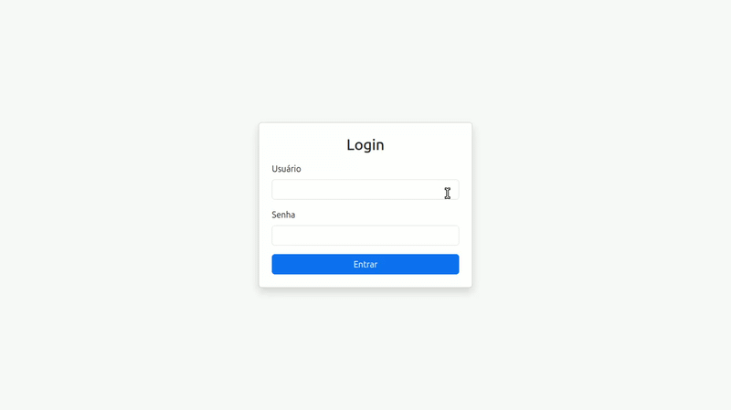

# Bolo Temático

Aplicação web para gestão de bolos temáticos, permitindo que o administrador do sistema controle suas operações de forma centralizada e organizada.

## Instruções de como executar a aplicação

### Requisitos

- [Maven](https://maven.apache.org/)

- Java 21 ou superior

- [MariaDB](https://mariadb.org/) instalado e em execução


### Configuração do banco local MariaDB

- Faça login no seu servidor de base de dados MariaDB com o usuário root

```shell
sudo mysql -u root -p
```
- Na primeira vez, exigirá a criação de uma senha para acesso ao MariaDB. (Guarde essa senha)

- Crie a base de dados:

```shell
create database bolotematico;
```

- Crie um usuário para acesso ao MariaDB

```shell
CREATE USER 'bolotematico-root'@'localhost' IDENTIFIED BY 'senha-root';
```
>obs.: o usuário e senha deve ser a mesma do arquivo `application.propeties`

- conceda todos os privilégios ao banco bolotematico

```shell
GRANT ALL PRIVILEGES ON bolotematico.* TO 'bolotematico-root'@'localhost';
FLUSH PRIVILEGES;
EXIT;
```

### Construa um JAR e Execute, conforme a [Documentação](https://spring.io/guides/gs/rest-service)

(Mac/Linux)
```shell
./mvnw clean package
```
```shell
java -jar target/bolo-tematico-0.0.1-SNAPSHOT.jar
```

(Windows)
```shell
.\mvnw.cmd clean package
```
```shell
java -jar target\bolo-tematico-0.0.1-SNAPSHOT.jar
```

### Acesse a aplicação no Navegador

http://localhost:8080/

### Acesso inicial

O sistema cria um usuário administrador padrão no primeiro deploy, conforme as variáveis configuradas no `application.properties`:

- username: `admin`
- password: `passadmin`

### Funcionalidades disponíveis

- Cadastro, Listagem, Edição e Exclusão de bolos
- Cadastro, Listagem, Edição e Exclusão de usuários
- Geração de relatório
- Login/logout

### Demonstração

